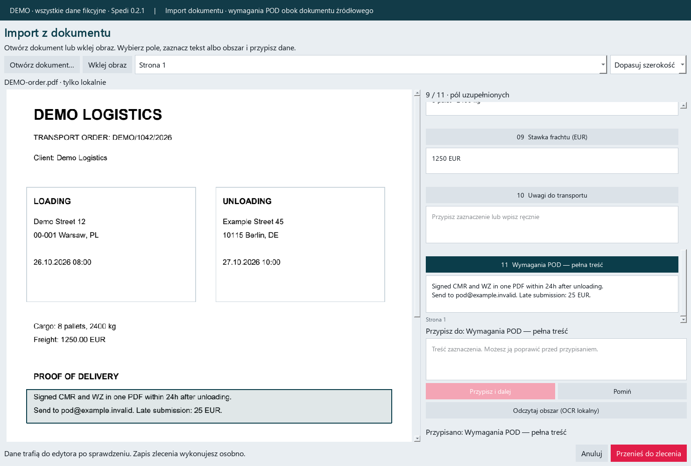

# Spedi

**English** · [Polski](README.pl.md)

## Download for Windows (64-bit)

[**Download the Spedi installer**](https://github.com/hudzialke/Spedi-Markus/releases/latest/download/Spedi-Setup.exe)

Open `Spedi-Setup.exe`, follow the installation wizard, then use the desktop
shortcut. No Python or terminal commands are needed. Offline OCR includes
Polish, English, German, French and Italian, with a 2 GiB memory limit and
one recognition task at a time.
[All releases and portable ZIP downloads](https://github.com/hudzialke/Spedi-Markus/releases).
Close Spedi before upgrading with a new installer. User databases and documents
are stored separately from application files.

A desktop application combining Brudnopis OT, Ewidentor, DDD Analyzer and
Dispatcher: weekly rest planning, tachograph analysis, working time records,
transport orders and freight settlements. **Spedi Android App** (formerly
MarkusDispatcher) in `mobile/` provides orders, deadlines and local reminders.

**Author: Patryk Prośniak (hudzialke).** Developed with the assistance of various
artificial intelligence (AI) models. Third-party authorship is documented in
[THIRD_PARTY_NOTICES.md](THIRD_PARTY_NOTICES.md).

## See Spedi in action

Import order details from a document, keep POD requirements with the order,
review weekly rest deadlines, analyze DDD activities, prepare monthly working
time records and calculate freight settlements. All examples use fictional data.



[**Explore the features and import demo →**](docs/showcase/README.md)

## License and responsibility

Released under the [MIT License](LICENSE). You may use, copy, modify and
redistribute the software, including commercially, while preserving the
copyright and license notices.

**Provided without warranty. The author accepts no liability for operation,
errors, data loss or consequences of use, to the extent permitted by law.**
Use at your own risk. Independently verify results and back up your data.
The application does not replace legal advice or regulatory compliance checks.
Changing the interface language does not change the applicable calculation
rules or the time zone of tachograph data.

## Run from source

Python 3.12 or later. All application modules and the parser are included.

```powershell
python -m venv .venv
.\.venv\Scripts\Activate.ps1
python -m pip install -e ".[dev,sync]"
python -m spedi
```

On Linux/macOS, activate with `source .venv/bin/activate`. Windows is the
primary desktop platform; the Google connection uses Windows DPAPI.

## Language

Choose **Polski** or **English** in the top-right selector, save your work and
restart Spedi. The preference is stored locally. Desktop interface translations
are in `spedi/locales/en.json`. Reports, detailed calculation explanations and
the Android application may still contain Polish text. User-entered content is
not translated. The **About** dialog includes authorship, AI disclosure and the
license summary.

## Data and integrations

This repository contains source code and synthetic tests. It excludes driver
databases, imported DDD files, transport documents, reports, passwords, tokens,
private keys, Firebase project configuration and private Google Drive/Sheets
references. Existing configured binaries are not included.

Brudnopis/Ewidentor data is stored in the user's Spedi directory; Dispatcher
uses its MarkusDispatcher user directory. Paths are determined by
`platformdirs`. Tests can override `SPEDI_DATA_DIR` and
`SPEDI_DISPATCHER_DATA_DIR`. First startup may migrate locally found legacy
application databases.

Integrations are optional and require each user's own configuration. Service
accounts, Google sign-ins and settings stay outside Git. **Never put a Firebase
service-account private key in the Android application.** Google Sheets is
separate from the phone connection.

- [Connect desktop and Android, step by step](docs/android-connection.md)
- [Spedi Android App](mobile/README.md)
- [Google Sheets setup](docs/google-sheets.md)
- [Publish source without private data](docs/publication.md)

## Test and build

```powershell
python -m pytest -q
python tools/public_export.py --check .
.\build.ps1
```

Windows output: `dist/Spedi/Spedi.exe`. Installer source:
`installer/Spedi.iss` (Inno Setup). Android is built separately after configuring
your own Firebase project.
