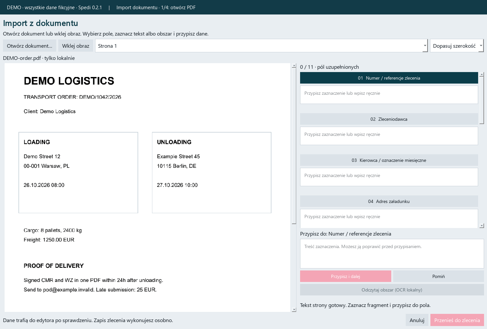
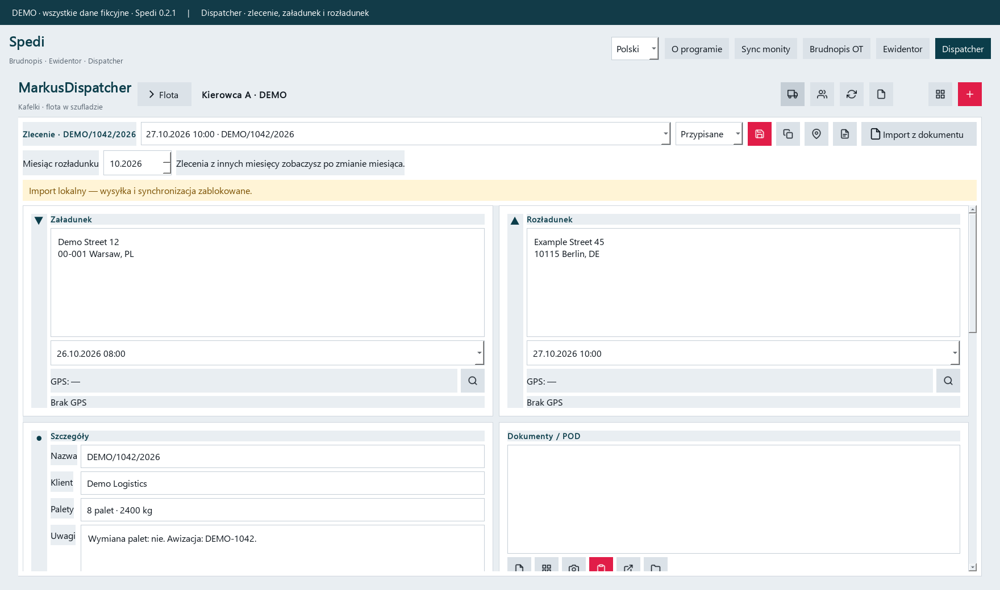
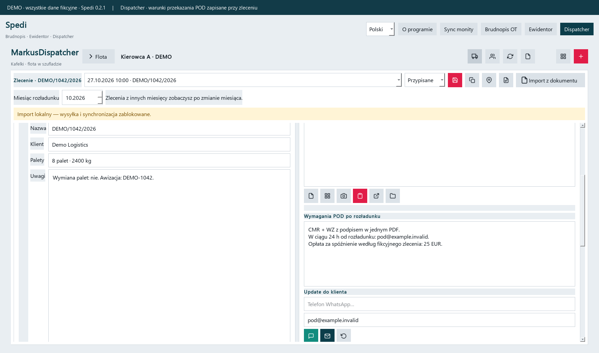
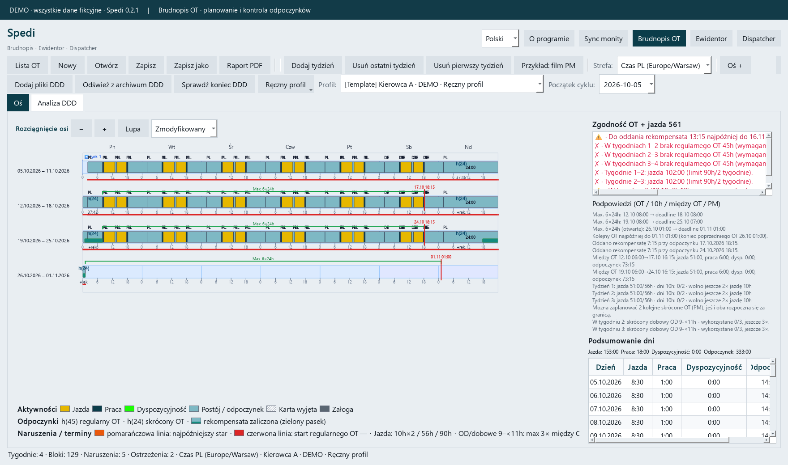
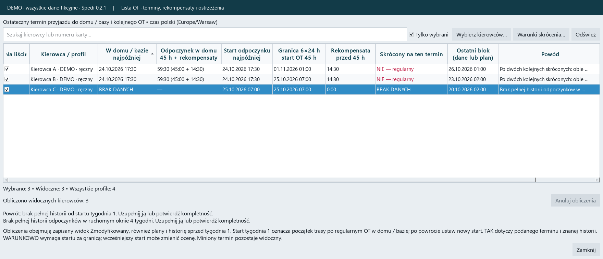
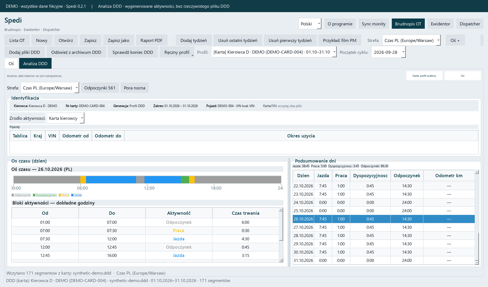
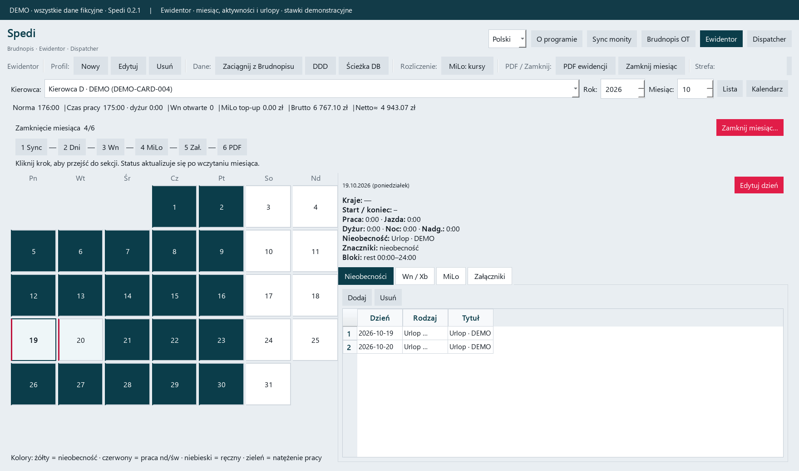
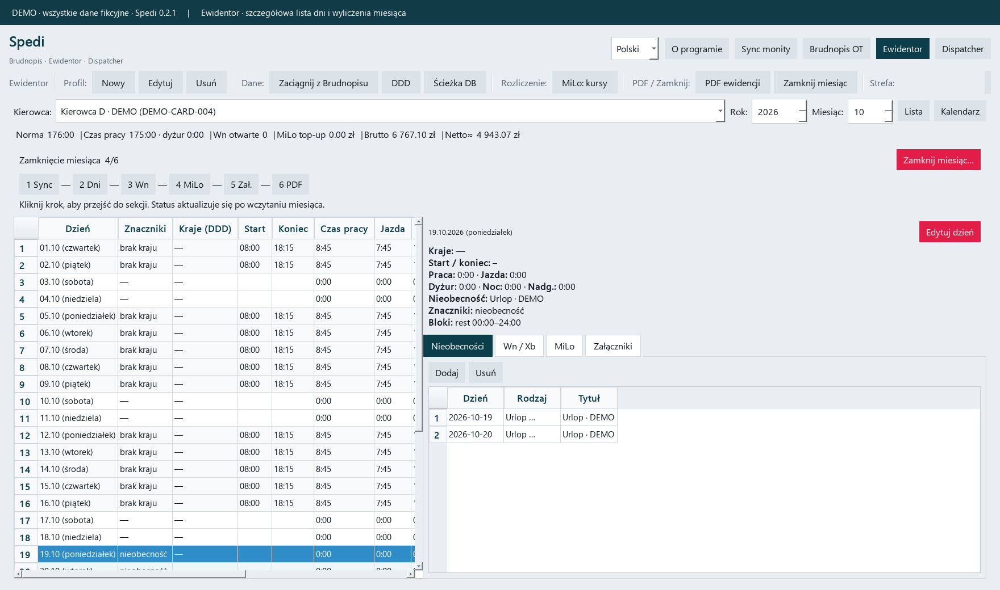
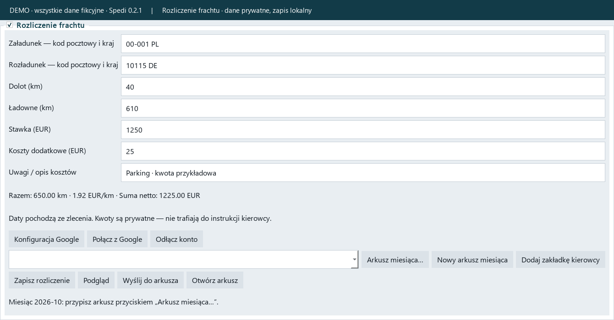

# Spedi in action

**English** · [Polski](README.pl.md)

Brudnopis OT, Ewidentor, DDD analysis and Dispatcher in one Windows application: weekly rest planning, working time records, transport orders, POD documents and freight settlements.

> A demonstration of **Spedi 0.2.1**. These are real application views populated with entirely fictional, generated fixtures. No real driver or customer databases or documents were used. Screenshots show the Polish interface; an English interface is also available.

## Import order details from a document

Open a PDF, Word document, Excel workbook, CSV or clipboard image. Choose a field, select the relevant text or area, review it and assign it to the form. Transfer the reviewed values to an order and save it.

The example uses loading and unloading addresses in adjacent PDF columns. Selecting each area keeps the two addresses separate. POD requirements go into their own field. Other values shown at the end were entered manually.

Text PDFs can be read without OCR. Scans and images can use local Tesseract with Polish, English, German, French and Italian language data. Recognition runs one task at a time with two threads and a 2 GiB OCR process memory limit. This is not a memory limit for the entire application.

Import is user-assisted: review and correct values before saving. Orders derived from local document imports have sending and synchronization blocked.

## Dispatcher and POD requirements

Assign an order to a driver and keep its customer, dates, references and documents together. Order history is organized by unloading month.

The fictional order DEMO/1042/2026 requires signed CMR and WZ in one PDF, sent within 24 hours to `pod@example.invalid`. Its stated late submission fee is EUR 25. The full wording remains available with the order.

**Storing POD requirements does not automatically send documents or schedule reminders from their text.** POD photos can be saved as PDF files in the local archive.

## Brudnopis OT: weekly rest planning

Plan and edit activities across multiple weeks; inspect weekly rests, compensation, warnings and violations. Both DDD profiles and manual profiles without a source file are supported. This demonstration deliberately includes findings requiring review.

The watchlist brings together deadlines for starting rest and returning home or to base, required compensation and explanations. Incomplete history remains marked **BRAK DANYCH** (insufficient data).

## DDD activity analysis

Inspect activities, exact times, daily summaries, rest analysis and night periods. The screenshot uses **generated activities in a demo profile**; no real DDD file was used.

## Ewidentor: working time records

Bring Brudnopis activities into monthly records, add absences and review individual days. View time and payroll calculations and export working time records to PDF. Pay and exchange rates shown here are illustrative.

## Freight settlement

Enter empty and loaded distance, freight price and additional costs. The panel calculates total distance, EUR/km and the amount after costs. Financial values stay out of driver instructions. This example is stored locally; nothing was sent to Google Sheets.

## Other features

- Polish and English interface; some reports and detailed explanations may remain in Polish.
- Local document archive, PDF reports and order history export to Excel.
- Optional Google Sheets and Android connection with each user's own configuration. This demo does not show a live connection.
- Click-to-run Windows installer, without terminal commands.

Calculation results depend on complete and accurate input. These screenshots demonstrate application usage.
